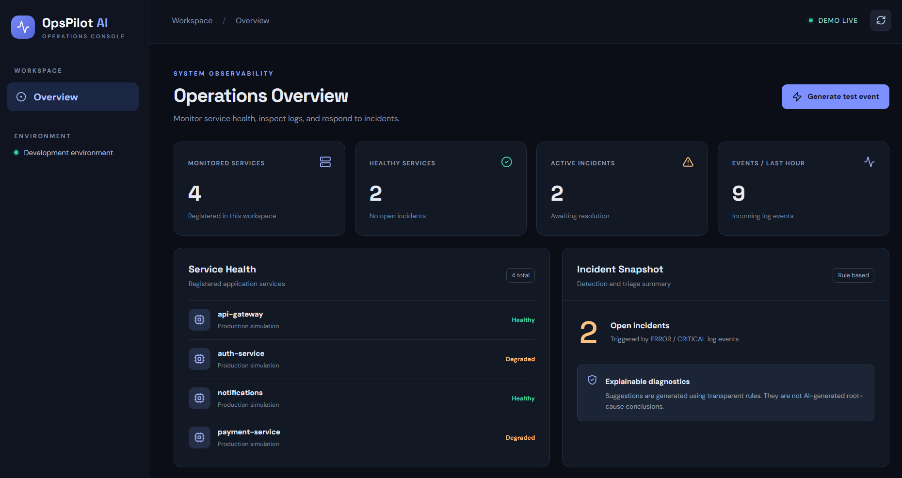

# OpsPilot AI

**Functional portfolio MVP (v0.1)** · Production monitoring and incident tracking simulator.

OpsPilot AI is a full-stack learning project for investigating application events. It demonstrates backend engineering, SQL persistence, a React dashboard, API design, incident workflows, and automated tests. The current version uses **rule-based incident explanations**. It does **not** claim genuine machine-learning anomaly detection or autonomous AI root-cause analysis.

## Implemented today

- FastAPI REST API with interactive OpenAPI docs at `/docs`
- SQLite persistence using SQLAlchemy (suitable for local demo)
- Four seeded simulated microservices
- Log ingestion endpoint (`POST /api/logs`) and randomized simulator (`POST /api/simulate`)
- Automatic incident creation on ERROR and CRITICAL logs; one open incident per service
- Rule-based investigation suggestions, clearly identified as heuristics
- Resolve incidents via the React dashboard
- React + Vite dashboard with service status, metrics, logs and incidents
- Tests for health, incident lifecycle, and invalid log levels
- Browser refresh every 12 seconds

## Requirements

- Python 3.10+ and Node.js 20+

## Quick start (Windows PowerShell)

**Terminal 1**

```powershell
cd backend
py -m venv .venv
.\.venv\Scripts\Activate.ps1
pip install -r requirements.txt
uvicorn app.main:app --reload --port 8000
```

**Terminal 2**

```powershell
cd frontend
npm install
npm run dev
```

Open **http://localhost:5173**. The API docs are at **http://localhost:8000/docs**.

On macOS/Linux, use `python3 -m venv .venv` and `source .venv/bin/activate`.

Use the **Generate test event** button to create simulated log events. ERROR/CRITICAL events create incidents. Select **Resolve** to close an incident.

## Run tests

```bash
cd backend
python -m pytest -q
```

## API endpoints

| Method | Path | Purpose |
| --- | --- | --- |
| GET | `/health` | Health check |
| GET | `/api/summary` | Dashboard counters |
| GET | `/api/services` | Registered services |
| POST | `/api/services` | Register a service |
| GET | `/api/logs` | Recent logs |
| POST | `/api/logs` | Ingest a log |
| POST | `/api/simulate` | Generate a random demo log |
| GET | `/api/incidents` | All incidents |
| PATCH | `/api/incidents/{id}` | Resolve or reopen an incident |

Example log:

```json
{"service_name":"checkout","level":"ERROR","message":"Database connection timeout"}
```

## Architecture

```text
React dashboard (Vite, port 5173)
       |
       | /api requests via Vite proxy
       v
FastAPI (port 8000)
       |
       v
SQLAlchemy -> SQLite (local file)
       |
       +--> rules for log severity and incident suggestions
```


## Dashboard Preview



### Features Demonstrated

- Real-time-style service health dashboard with automatic refresh
- Simulated microservice log generation
- Error-based incident detection and tracking
- Incident severity and status monitoring
- Rule-based investigation suggestions
- Incident resolution workflow
- FastAPI backend with SQLite persistence
- React frontend with interactive monitoring views


## Security and limitations

**This is a development demo, not a production monitoring system.** There is no authentication or RBAC, the server accepts unauthenticated logs, the storage is SQLite, and there are no real alert notifications, rate limits, metrics ingestion or distributed tracing. Never expose the API to the public internet or submit real user/production logs. The frontend is intentionally pointed at the local backend via Vite's dev proxy.

The `.gitignore` excludes environment files, virtual environments, node modules, caches, and local database files. Scan your own files before publishing, and never commit API keys.

## Roadmap (not implemented yet)

- [ ] PostgreSQL and migration tooling
- [ ] JWT authentication and role-based permissions
- [ ] Structured OpenTelemetry log and metric ingestion
- [ ] Sliding-window anomaly detection and incident deduplication
- [ ] Real LLM-backed incident triage with documented guardrails
- [ ] GitHub integration and alert notifications
- [ ] Docker-based deployment and production CI/CD
- [ ] Monitoring, dashboards and tracing

## Project status and attribution

This starter was scaffolded with AI assistance as a learning portfolio project. The goal is to study each component, test it, and incrementally implement the roadmap. Do not represent the unfinished roadmap as delivered functionality.
